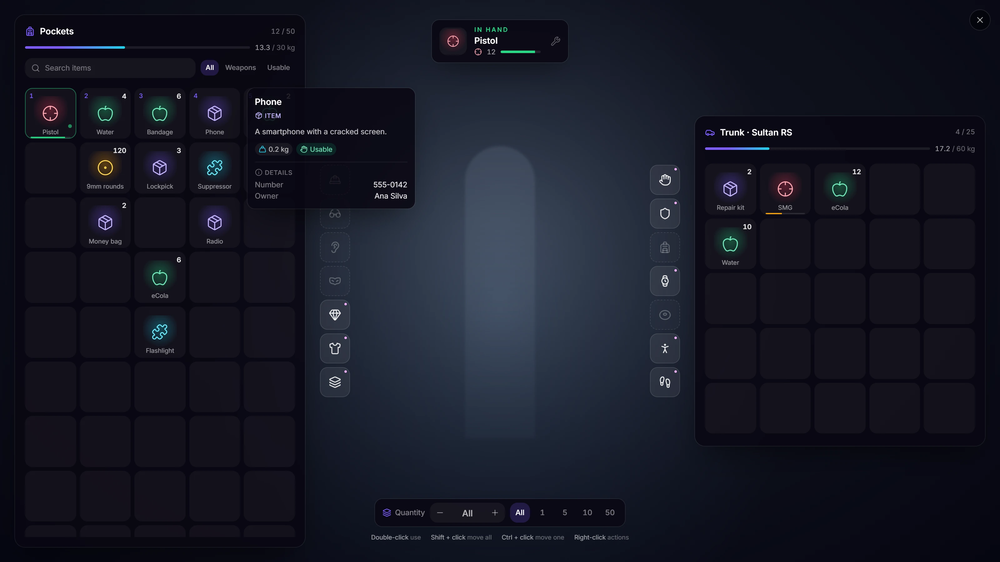
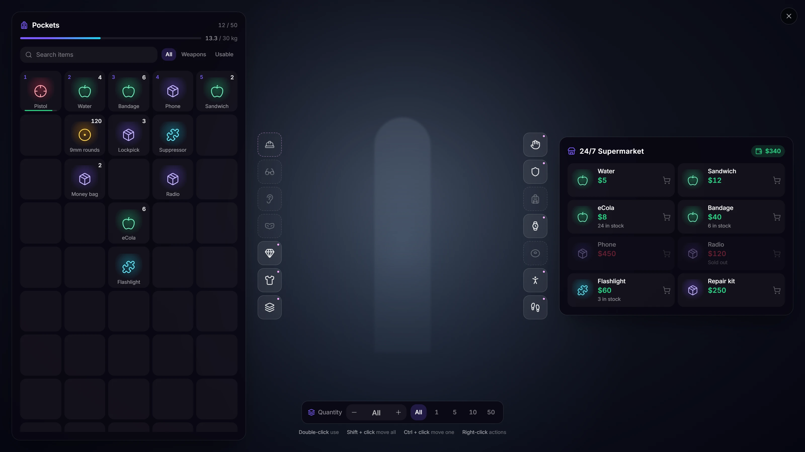
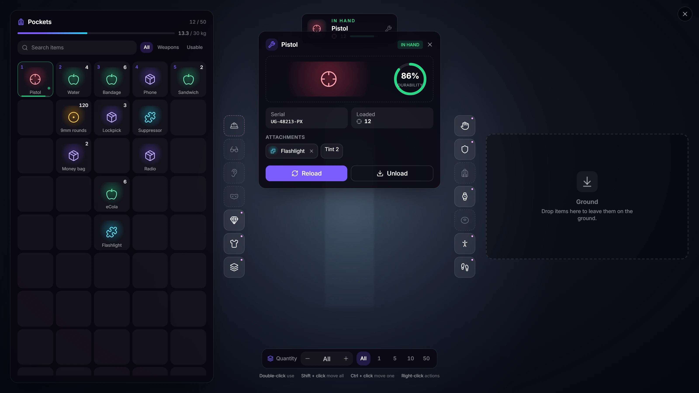
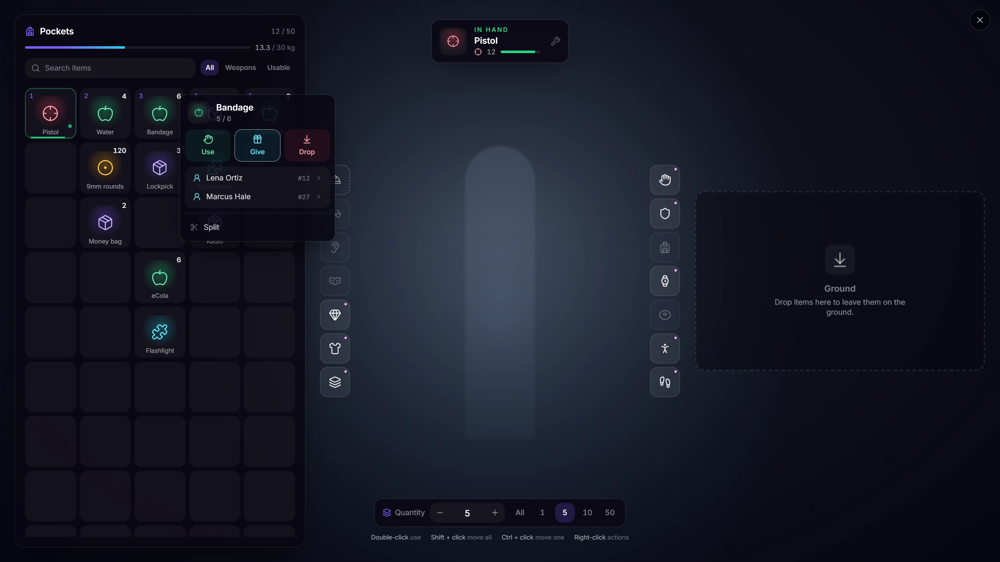
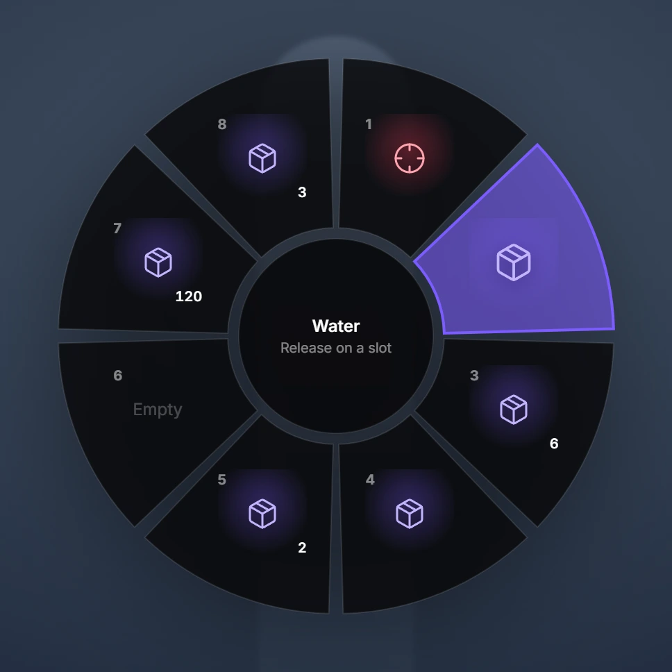

<div align="center">

# ⬢ ug-inventory

**The inventory screen for UgCore. Drag and drop with your character on stage, quick actions, smart opening, a
quick-use wheel, a weapon workbench and shops, on top of ug-core's server-authoritative inventory.**

[](https://ugcore.urging.ch/ug-inventory/introduction)
[](https://github.com/ugcore-project/ug-inventory/actions/workflows/ci.yml)
[](LICENSE)
[](https://discord.gg/pCJUcyVw5X)

[**Documentation**](https://ugcore.urging.ch/ug-inventory/introduction) · [**Installation**](https://ugcore.urging.ch/ug-inventory/installation) · [**Configuration**](https://ugcore.urging.ch/ug-inventory/configuration) · [**API**](https://ugcore.urging.ch/ug-inventory/api) · [**Inventory module**](https://ugcore.urging.ch/api/inventory)


</div>

---

Press one key and the inventory opens with whatever is in reach next to it: the glovebox of the car you sit in, the
closest trunk, a bag on the ground, a stash or a shop. Your character stands in the middle, the way the pause menu
shows it, between your pockets and the other side. Drag between slots, pick a quantity at the bottom, and right-click
for use, give and drop.

ug-inventory holds no inventory logic. Items, weights, stacks, containers, weapons and shops live in ug-core, which
checks every move, distance and price on the server. This resource shows them, and asks.

## Preview

| Pockets and a trunk | Shop | Weapon workbench |
| :---: | :---: | :---: |
|  |  |  |

| Quick actions | Quick-use wheel | Hotbar and pickups |
| :---: | :---: | :---: |
|  |  |  |

## Features

- 🧍 **Character on stage.** Your character stands in the middle, drawn by the game like in the pause menu, with what
  they wear and hold. The weapon in hand shows above, with its ammo and condition.
- 🎯 **Smart open key.** `TAB` opens the closest glovebox, trunk, drop, stash or shop in reach, or the pockets alone.
  Locked trunks are skipped. The trunk door opens while you look inside.
- ✋ **Drag and drop.** Onto a slot to move, merge or swap, onto the ground panel to drop, onto the workbench to fit.
- 🖱️ **Mouse shortcuts.** Double-click uses an item, or takes it from the other side. **Shift**-click moves the stack to
  the other side, **Ctrl**-click moves one.
- 🎚️ **Quantity bar.** Pick how many units drags, moves, gives and drops take: all, 1, 5, 10, 50 or any number.
- ⚡ **Quick actions.** Right-click for **Use**, **Give** and **Drop** in one click, with the nearby players to give to.
  Then inspect, move and split.
- 🏷️ **Every detail.** Hover an item for its description, weight, category and metadata: serial numbers, plates,
  frequencies, whatever your resources store on it.
- 🎨 **Colour-coded.** ug-core's violet and cyan, with one colour per category: weapons, ammo, attachments,
  consumables. 50 slots, and every slot lights up under the mouse.
- ✅ **Instant, and still the server's call.** Moves show at once. When ug-core refuses, the slots snap back and the
  reason shows: too heavy, too far, not allowed.
- 🔫 **Weapon workbench.** Serial, durability, loaded ammo and attachments. Drop an attachment or a tint on the weapon
  to fit it, remove one with a click, reload or unload the weapon in hand. ug-core decides what fits.
- 🛒 **Shops.** Prices, stock, and what you can afford against your balance. Drag an item to your pockets or click it
  and pick an amount.
- 🎡 **Quick-use wheel.** Hold `Z`, point at a slot, release. You keep walking while you choose.
- 🔢 **Hotbar.** Keys `1` to `5` use slots 1 to 5 and flash the hotbar. The GTA weapon wheel is turned off: weapons are
  items.
- 🔔 **Pickup toasts.** Items gained and lost slide in at the edge of the screen, open or not.
- 👕 **Clothing slots.** Fourteen pieces around the character, from hat to shoes. Click to take one off with an
  animation, click again to put it back on. Or switch to items mode: pieces come off as items to store, give or drop,
  and go back on when dragged onto their slot.
- 🔊 **Game sounds.** Opening, hovering, picking up and every result play GTA frontend sounds. Owners MAY turn them off.
- 🔍 **Search and filters.** Search by name, filter weapons or usable items. Weight bars turn amber, then red.
- 🧩 **Your theme.** ug-lib's theme applies, so the inventory matches every UgCore screen. Item images are yours to add.

## Requirements

- OneSync.
- [ug-core](https://github.com/ugcore-project/ug-core) 1.0.0 or newer, with the `items` and `inventory` modules.
  `weapons`, `shops` and `accounts` add the workbench, shops and balances when enabled.
- [ug-lib](https://github.com/ugcore-project/ug-lib) 1.0.0 or newer.

## Installation

Download a release, extract it to your resources folder and start it after ug-core and ug-lib:

```cfg
ensure oxmysql
ensure ug-core
ensure ug-lib
ensure ug-appearance   # only for clothingMode = 'items'
ensure ug-inventory
```

On the first start, `server/config.default.lua` is copied to `config.lua`. Updates never overwrite it. The console prints
`[ug-inventory] v1.0.0 ready. 2 stash point(s), weapons on, shops on, clothing toggle.` and each client prints
`[ug-inventory] Ready: hotbar 5, wheel 8.` in F8.

### Item images

Put one image per item in `images/`, named after the item: `water.png`, `weapon_pistol.png`. PNG or WebP, square,
128x128 or larger, transparent background. Items without an image show an icon in the colour of their category.

### Item details

The tooltip shows the description of the item (ug-core's `description` field in `config/items.lua`) and every plain
metadata field of the stack: text, numbers and booleans, at most 12. Name a field in the locale under
`page.metadata.<key>`, or it shows as words from the key: `plateNumber` becomes "Plate number".

## Configuration

Slots, weights, items, stashes, trunks, weapons and shops are ug-core config (`config/inventory.lua`, `config/items.lua`
and others). `config.lua` here sets how the screen behaves. See [Configuration](https://ugcore.urging.ch/ug-inventory/configuration) and
[Look and sounds](https://ugcore.urging.ch/ug-inventory/configuration-look) for every option:

| Key | Default | Purpose |
| --- | --- | --- |
| `openKey` | `'TAB'` | Opens the inventory with what is in reach. Players MAY rebind it. |
| `wheelKey` | `'Z'` | Held to show the quick-use wheel. Players MAY rebind it. |
| `hotbarSlots` | `5` | Slots 1 to N are the hotbar, used with keys 1 to N. At most 9. |
| `wheelSlots` | `8` | Slots 1 to N are on the wheel. At most 10, 0 turns it off. |
| `trunkDistance` | `1.5` | Meters to a trunk for the open key. |
| `dropDistance` | `2.0` | Meters to a ground drop. |
| `stashDistance` | `2.0` | Meters to a stash with `coords` in ug-core's config. |
| `shopDistance` | `2.5` | Meters to a shop. |
| `giveDistance` | `3.0` | Meters to a player offered as a give target. |
| `respectLocks` | `true` | The open key skips the trunks of locked vehicles. |
| `pedPreview` | `true` | Shows the character in the middle, the way the pause menu shows it. |
| `toasts` | `true` | Shows items gained and lost. |
| `sounds` | `true` | Plays game sounds for the screen and its actions. |
| `clothing` | `true` | Shows clothing slots next to the character. |
| `clothingMode` | `'toggle'` | `'toggle'` or `'items'`. See [Clothing](#clothing). |
| `clothingPieces` | all 14 | Slots shown, in order: the first half on the left, the rest on the right. |
| `clothingNaked` | `{}` | Drawable a model wears without a piece, by model, for ped components. |
| `disableWeaponWheel` | `true` | Hides the GTA weapon wheel and its keys. |
| `dropModel` | `'prop_paper_bag_small'` | Prop shown at ground drops. |
| `dropRenderDistance` | `40.0` | Meters at which drop props show. |
| `giving` | `true` | Give items to players nearby. Off hides it and the screen refuses it. |
| `dropping` | `true` | Drop items on the ground. Off shows an empty place instead of the ground. |
| `workbench` | `true` | Inspect a weapon and change its attachments. |
| `toastDuration` | `3500` | Ms an item gained or lost stays on screen, 1000 to 15000. |
| `theme` | `{}` | This screen's look on top of ug-lib's theme. See [Look and layout](#look-and-layout). |
| `layout` | see below | Where things are and what shows. Fields left out keep their default. |
| `soundEffects` | 14 sounds | `{ name, set }` of `PlaySoundFrontend` per sound. A sound left out is muted. |
| `previewAnimations` | idle, give, buy, drop | `{ dict, name, duration? }` the character preview plays. One left out plays nothing. |
| `clothingAnimations` | one per piece | `{ dict, name, duration, upperBody? }` played while a piece changes. One left out plays nothing. |

Distances only choose what the open key asks for. ug-core checks every distance again on the server.

### Look and layout

Every UgCore screen follows ug-lib's theme (`config/theme.lua` of ug-lib). `theme` here changes this screen only, and
any field MAY be left out: `mode` (`'dark'` or `'light'`), `colors`, `radius` (`'0.75rem'`, `'12px'`), `font`
(`'Inter'`) and `scale` (0.75 to 1.5). `colors` takes HSL triplets for ug-lib's tokens (`primary`, `accent`,
`background`, `destructive`, `success`, ...) and this screen's own: `weapon`, `ammo`, `attachment`, `consumable`,
`clothing` and `item` color the item categories, `overlay` darkens the sides around the character.

```lua
theme = { colors = { primary = '200 90% 55%', weapon = '0 85% 70%' }, radius = '4px' },
layout = { pockets = 'right', columns = 6, slotSize = 4.5, hints = false, toasts = 'top-left' },
```

| `layout` field | Default | Purpose |
| --- | --- | --- |
| `pockets` | `'left'` | Side of the player's pockets: `'left'` or `'right'`. The other inventory takes the other side. |
| `columns` | `5` | Slots per row, 3 to 10. |
| `slotSize` | `5.1` | Slot size in rem, 3.5 to 8. Panels grow with columns and slot size. |
| `vignette` | `true` | Darkens the sides so panels read over any scene. |
| `hints` | `true` | Mouse hints under the character. |
| `quantityBar` | `true` | The quantity picker under the character. |
| `quantityPresets` | `{ 1, 5, 10, 50 }` | Quantity buttons, at most 6. "All" is always there. |
| `closeButton` | `true` | The X in the corner. |
| `hotbar` | `'bottom'` | Where the hotbar shows: `'bottom'` or `'top'`. |
| `toasts` | `'bottom-right'` | `'bottom-right'`, `'bottom-left'`, `'top-right'` or `'top-left'`. |
| `animations` | `true` | `false`: panels appear without motion. |

### Clothing

The slots read the player's ped, so they match whatever dressed it. See [Clothing](https://ugcore.urging.ch/ug-inventory/clothing).

- **Toggle mode** (default) changes the ped on the client and remembers each piece to put it back. Nothing becomes an
  item, so nothing can be duplicated. Pieces taken off go back on when the resource stops.
- **Items mode** needs [ug-appearance](https://github.com/ugcore-project/ug-appearance) started before ug-inventory.
  ug-inventory registers one item per piece (`clothing_hat`, `clothing_top`, ...) with the model, drawable and texture
  as metadata. Taking a piece off adds the item first, then saves the appearance without it; wearing an item swaps it
  with the piece worn. Every step is undone when the next one fails, and a player runs one change at a time. Clothes
  made for another model do not fit. ug-appearance outfits and uniforms still dress for free, so give clothing items no
  resale value.

Pieces off use the base game's drawables of the freemode models. Add-on peds show their props only, until
`clothingNaked` lists their components: `{ my_addon_ped = { top = 15, legs = 21 } }`. The bare legs, feet and
undershirt values of the freemode models SHOULD be checked on a live server.

## Exports

Client exports, for targets, jobs and housing. ug-core still checks reach and access. See the [API](https://ugcore.urging.ch/ug-inventory/api).

```lua
exports['ug-inventory']:Open()                 -- the pockets alone
exports['ug-inventory']:OpenStash('police')    -- a stash by name
exports['ug-inventory']:OpenTrunk(vehicle)     -- a trunk or glovebox by vehicle entity
exports['ug-inventory']:OpenGlovebox(vehicle)
exports['ug-inventory']:OpenDrop(dropId)
exports['ug-inventory']:OpenShop('247_legion')
exports['ug-inventory']:Close()
local open = exports['ug-inventory']:IsOpen()
```

Server code MAY open any inventory for a player with ug-core's `UgCore.Inventory.Open(source, inventoryId)`, such as
another player's pockets for ug-admin's `/inventory` or a search. The screen opens with it next to the pockets, as kind
`inventory`, or shows it in place of the other side when the screen is already open.

Client events, through `UgCore.Events.On`: `ug-inventory:Opened` with the kind of what opened next to the pockets
(nil for none), and `ug-inventory:Closed`.

## Security

The page is untrusted: any script in CEF can post to its callbacks. Every body is checked with a `UgCore.Schema` rule
and the page has a budget of 40 posts a second. The page sends intent only, slots and counts. ug-core's callbacks
check the rest again on the server, with their own rate limits, `requireAlive`, distances and Guard flags.

## Project structure

```text
ug-inventory/
├── fxmanifest.lua
├── shared/              the global and enums
├── server/              defaults, config, stash points, boot
├── client/              page bridge, state mirror, screen, open key, character preview, hotbar and wheel, drops, boot
├── images/              item images, sent to players
├── locales/             en, pt
├── web/                 React page, built to web/dist
├── tests/               Lua 5.4 tests with native mocks, never shipped
├── skills/              task guides for AI agents, never shipped
├── AGENTS.md            rules for AI agents and humans
└── CLAUDE.md            points Claude Code to AGENTS.md
```

## Development

Clone ug-core and ug-lib next to this repository: the tests and the type check read them from `../ug-core` and
`../ug-lib`, or from the `UG_CORE` and `UG_LIB` paths.

```bash
# 1. LuaLS strict check, zero problems, with ug-core, ug-lib and the CfxLua natives as libraries
lua-language-server --check . --checklevel=Information --configpath=.luarc.json

# 2. Lua tests
for suite in tests/*.lua; do [ "$suite" = tests/helpers.lua ] || lua5.4 "$suite" || exit 1; done

# 3. Manifest, license headers and README images
lua5.4 .github/scripts/check-repository.lua
```

The page needs Node.js 20.19 or newer:

```bash
cd web
npm ci
npm run lint && npm run typecheck && npm test
npm run build && npm run budget   # web/dist, at most 400 KB gzipped
npm run dev                       # browser preview with buttons that play the showcase scenes
npm run capture                   # README images from the scenes, to .github/assets
```

The README images come from the scenes in `web/src/dev/scenes.ts`: see [skills/readme-preview](skills/readme-preview/SKILL.md).

### Working with AI agents

[AGENTS.md](AGENTS.md) holds the conventions and security rules every agent MUST follow. Claude Code reads it through
`CLAUDE.md`; Codex, Cursor and others read `AGENTS.md` directly. Task guides:

| Skill | For |
| --- | --- |
| [nui-page](skills/nui-page/SKILL.md) | The page, its messages and callbacks |
| [config](skills/config/SKILL.md) | Owner config options |
| [testing](skills/testing/SKILL.md) | Lua and web tests |
| [readme-preview](skills/readme-preview/SKILL.md) | README features and images |
| [ug-core-api](skills/ug-core-api/SKILL.md) | What ug-core and ug-lib offer |

### Releases

Releases are automated. release-please keeps a `chore: release X.Y.Z` pull request open on `main` that bumps
`version` in `fxmanifest.lua` and `CHANGELOG.md` from Conventional Commits. Merging it tags `vX.Y.Z`, builds the page
and attaches `ug-inventory.zip` with only what a server runs. Every push to `dev` replaces the `dev-build` pre-release.
Merge `dev` into `main` with a merge commit, never squash. Commit subjects become the changelog: write them for owners.

## Contributing

Branch off `dev` and open a pull request to `dev`. Commits and PR titles follow
[Conventional Commits](https://www.conventionalcommits.org): lowercase imperative subject, no trailing period, 72
characters at most. Scopes: `core`, `api`, `nui`, `web`, `config`, `locale`, `ci`, `deps`.

Read the [contributing guide](https://github.com/ugcore-project/.github/blob/main/CONTRIBUTING.md) and the
[Code of Conduct](https://github.com/ugcore-project/.github/blob/main/CODE_OF_CONDUCT.md).

## Security reports

Never report a vulnerability in a public issue. [Report it privately](https://github.com/ugcore-project/ug-inventory/security/advisories/new)
and read the [Security Policy](https://github.com/ugcore-project/.github/blob/main/SECURITY.md).

## License

ug-inventory is free software, licensed under the [GNU General Public License v3.0](LICENSE).

Copyright (C) 2026 UgCore Framework & Contributors.
